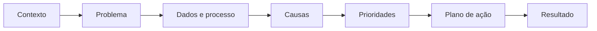

# Gabriel Januário

### Business Analyst | Operations & Performance

**Transformo dados operacionais em diagnósticos, prioridades e planos de ação.**

---

## Minha proposta de valor

| DIAGNOSTICAR | ESTRUTURAR | MOBILIZAR |
|:---:|:---:|:---:|
| Investigar indicadores, desvios, gargalos e causas | Traduzir análises em processos, prioridades e planos mensuráveis | Conectar áreas, acompanhar a execução e sustentar resultados |

Sou formado em **Gestão da Produção Industrial** e construí aproximadamente 13 anos de experiência em operações industriais, da execução ao planejamento e à análise. Essa trajetória me ensinou a compreender o processo antes de propor a solução e a tratar dados como instrumentos de decisão — não apenas de reporte.

Atuo na interseção entre **operação, processos e performance**, conectando capacidade, demanda, prazos, riscos, indicadores e stakeholders. Meu objetivo profissional é aplicar essa base em posições de **Business Analyst**, **Analista de Operações**, **Performance** ou **Processos**.

> **Dados explicam o desvio. Processos mostram onde atuar. Execução transforma análise em resultado.**

---

## Cases em destaque

| Projeto Horizonte | Master Production Planning |
|---|---|
| **Recuperação de performance em uma rede de clínicas** | **Planejamento e performance industrial** |
| Case autoral aplicado a uma rede fictícia de 12 clínicas, com diagnóstico integrado e plano de recuperação de 90 dias. | Projeto baseado em experiência profissional, com dados anonimizados, conectando carteira, capacidade e prioridades. |
| `KPIs` `Causa raiz` `AS-IS / TO-BE` `Power BI` `Plano de ação` | `Backlog` `Lead time` `Capacidade` `Excel` `Power BI` |
| **Em desenvolvimento:** base auditável, diagnóstico e dashboard executivo. | **Em desenvolvimento:** refinamento dos indicadores, layout e dashboard. |

### O que esses projetos demonstram

- estruturação de problemas e perguntas de negócio;
- definição, documentação e análise de KPIs;
- mapeamento de processos e identificação de gargalos;
- análise de causa raiz e priorização por impacto;
- construção de recomendações e planos de ação;
- comunicação executiva e acompanhamento de resultados.

---

## Competências essenciais

| Operações & Performance | Processos & Melhoria | Dados & Decisão |
|---|---|---|
| Gestão de KPIs | Mapeamento de processos | Excel para análise e controles |
| Diagnóstico operacional | Lean, VSM e Kaizen | Power BI em desenvolvimento |
| Capacidade e demanda | PDCA, Pareto e 5 Porquês | SQL em desenvolvimento |
| Planejamento e controle | Ishikawa e análise de riscos | Dashboards e relatórios |
| Planos de ação | Gestão de stakeholders | Storytelling com dados |

### Ferramentas e ambientes

---

## Formação e desenvolvimento

| Formação e certificações | Desenvolvimento atual |
|---|---|
| Gestão da Produção Industrial — **FATEC** | Analista de Performance — **Petra Cursos** |
| Professional Scrum Master I — **Scrum.org** | Business Analysis — **IBM/Coursera** |
| Gestão de Projetos — **FGV** | Power BI, modelagem de dados e DAX |
| Lean Practitioner | SQL e Python para análise de dados |
| Revenue Operations — **HubSpot Academy** | BPMN e modelagem de processos |

---

## Meu método de trabalho

---

### Vamos transformar problemas operacionais em decisões melhores?

**Business Analysis • Operations & Performance • Processos • Melhoria Contínua**

